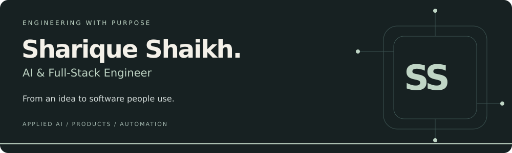
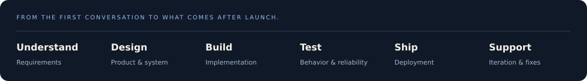

  

  <a href="https://shariqueshaikh.vercel.app/"><strong>EXPLORE MY WORK ↗</strong></a>
  &nbsp;&nbsp; / &nbsp;&nbsp;
  <a href="https://ss-services.vercel.app/"><strong>SS SERVICES ↗</strong></a>
  &nbsp;&nbsp; / &nbsp;&nbsp;
  <a href="https://www.linkedin.com/in/shariqueshaikh125/"><strong>LET'S CONNECT ↗</strong></a>

 

## One engineer. A full spectrum of software.

I'm **Sharique Shaikh**, a **Software & AI Engineer** and the founder of **SS Services**, based in Pakistan.

I turn ideas and business requirements into usable software: **web and mobile applications, SaaS products, AI-powered tools, automation, and custom business systems**. My work connects the product people use with the data, APIs, and workflows behind it.

I work across industries—not within a single niche. Whether the brief is a customer-facing app, an internal operations platform, or a connected business workflow, I bring the same focus: understand the problem, design the system, build it carefully, and support it after launch.

 

## What I can help you build

<table>
  <tr>
    <td width="50%" valign="top">
      <h3>01 / Web Applications</h3>
      
SaaS platforms, customer portals, booking systems, dashboards, e-commerce experiences, and responsive business websites.

      React · Next.js · TypeScript · Node.js
    </td>
    <td width="50%" valign="top">
      <h3>02 / Mobile Applications</h3>
      
Native Android and cross-platform applications, with connected APIs, authentication, notifications, and offline functionality where needed.

      Kotlin · Jetpack Compose · Flutter · Firebase
    </td>
  </tr>
  <tr>
    <td width="50%" valign="top">
      <h3>03 / AI &amp; Intelligent Tools</h3>
      
AI agents, document-based assistants, LLM integrations, and tools that turn unstructured information into useful product features.

      Python · OpenAI · Claude · Gemini
    </td>
    <td width="50%" valign="top">
      <h3>04 / Automation &amp; Integrations</h3>
      
Business workflow automation, WhatsApp and CRM integrations, connected APIs, and tools that reduce repetitive operational work.

      Python · Node.js · n8n · APIs &amp; Webhooks
    </td>
  </tr>
  <tr>
    <td width="50%" valign="top">
      <h3>05 / Business Software</h3>
      
Custom CRMs, ERP modules, admin platforms, inventory and order workflows, and internal tools shaped around how a business operates.

      PostgreSQL · Supabase · Role-Based Access
    </td>
    <td width="50%" valign="top">
      <h3>06 / Custom Engineering</h3>
      
Purpose-built software, backend services, data tools, third-party integrations, and specialist systems when an off-the-shelf product isn't enough.

      TypeScript · Python · C# · SQL
    </td>
  </tr>
</table>

 

## A few things I've built

### Sunday Shine — a service business, connected

A car-detailing booking experience with service selection, an owner area, cancellation and rescheduling, and reminders. The focus: making the customer journey and the owner's daily workflow work together.

**[Explore the live application ↗](https://sundayshine.lovable.app/)**

### PrivateEye — self-hosted search infrastructure

A custom-branded search setup built on SearXNG, with Docker Compose, Caddy, Valkey, and optional Tor routing. A project combining interface customization with self-hosted infrastructure.

**[Explore the public repository ↗](https://github.com/Sharique-shaikh-git/PSE-Private_Search_Engine-)**

### Mobile products — Noor App & CryptoPartner

Mobile projects covering Islamic daily tools and trading signals, including prayer, Qibla, habits, and related utilities. These projects demonstrate another part of my work: mobile interfaces, application state, and connected features.

**[More projects and engineering work ↗](https://shariqueshaikh.vercel.app/)**

Some product and client repositories are private. Public GitHub activity represents only part of my work.

 

## My working toolkit

| Layer | Technologies |
| :--- | :--- |
| **Frontend & interfaces** | React · Next.js · TypeScript · JavaScript · Tailwind CSS · Framer Motion |
| **Mobile** | Kotlin · Jetpack Compose · Flutter · Firebase |
| **Backend & data** | Python · Node.js · C# · PostgreSQL · Supabase · SQL |
| **AI & automation** | OpenAI · Claude · Gemini · n8n · faster-whisper · FFmpeg |
| **Delivery & infrastructure** | Git · GitHub · Docker Compose · API integrations |
| **Additional specialist tools** | MQL4 / MQL5 · cTrader / cAlgo · NinjaTrader 8 |

 

 

## From my public workspace

<!-- PUBLIC-WORK:START -->
| Public project | Repository description | Last push (UTC) |
| :--- | :--- | :--- |
| [C-compiler-in-C](https://github.com/Sharique-shaikh-git/C-compiler-in-C) | Explore the repository for project details. | 2026-08-31 |
| [PSE-Private&#95;Search&#95;Engine-](https://github.com/Sharique-shaikh-git/PSE-Private_Search_Engine-) | Explore the repository for project details. | 2026-08-28 |
| [Shopo&#95;free](https://github.com/Sharique-shaikh-git/Shopo_free) | Explore the repository for project details. | 2026-08-08 |

Last refreshed: 2026-10-19 UTC
<!-- PUBLIC-WORK:END -->

Automatically refreshed from my public repositories. For client work and private products, explore my portfolio.

 

---

### Let's build something that fits the way you work.

Open to **software and AI engineering roles**, **remote collaboration**, and **client projects** across web, mobile, automation, and business software.

**[View my portfolio →](https://shariqueshaikh.vercel.app/)** &nbsp;&nbsp; **[Discuss a project with SS Services →](https://ss-services.vercel.app/)** &nbsp;&nbsp; **[Connect on LinkedIn →](https://www.linkedin.com/in/shariqueshaikh125/)**
