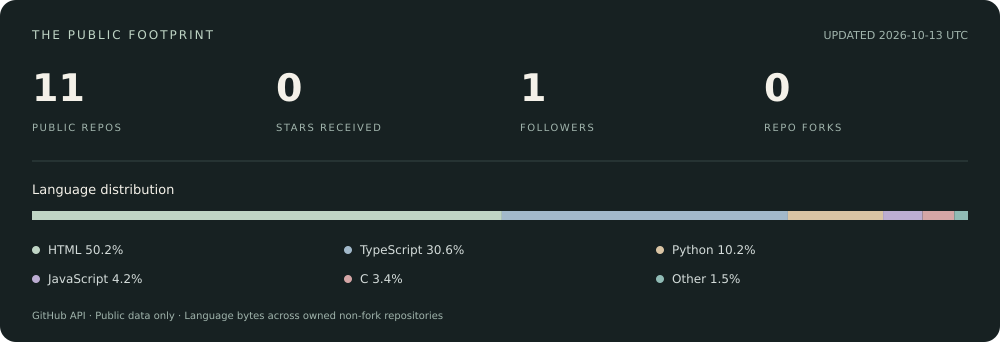

  

  <a href="https://shariqueshaikh.vercel.app/"><strong>Portfolio ↗</strong></a>
  &nbsp; · &nbsp;
  <a href="https://ss-services.vercel.app/"><strong>SS Services ↗</strong></a>
  &nbsp; · &nbsp;
  <a href="https://www.linkedin.com/in/shariqueshaikh125/"><strong>LinkedIn ↗</strong></a>

Based in Pakistan · Remote collaboration · Open to engineering roles and client projects

---

### Software that earns its place in a business.

I'm **Sharique**, an **AI & Full-Stack Engineer** and the founder of **[SS Services](https://ss-services.vercel.app/)**. I build web applications, AI integrations, and automation that connect real business workflows—from booking a service to processing documents or executing a trading strategy.

My work spans **React / Next.js, TypeScript, Python, and LLM APIs**. I take projects from requirements through implementation, testing, and deployment, with attention to the details that matter after launch: clear interfaces, reliable data, and maintainable code.

### What I build

| Focus | Work |
| :--- | :--- |
| **Applied AI** | Document-based assistants, LLM integrations, AI agents, and automated content workflows |
| **Full-stack products** | SaaS applications, booking systems, dashboards, APIs, and business tools |
| **Business automation** | CRM integrations, WhatsApp workflows, connected services, and repetitive-task automation |
| **Trading & mobile** | MT4/MT5 expert advisors, cTrader and NinjaTrader tools, and Android applications |

### Selected work

**[Sunday Shine ↗](https://sundayshine.lovable.app/)**  
A car-detailing booking experience with service selection, an owner area, cancellation and rescheduling, and reminders. Built around the everyday needs of a solo business owner.

**[PrivateEye ↗](https://github.com/Sharique-shaikh-git/PSE-Private_Search_Engine-)**  
A self-hosted search setup built on SearXNG, with custom branding, Docker Compose, Caddy, Valkey, and optional Tor routing.

**CryptoPartner · Noor App**  
Mobile projects spanning trading signals and Islamic daily tools. Source code is private; project details are available through my portfolio.

### Tools I work with

  
  
  
  
  
  
  
  

**AI & automation:** OpenAI · Claude · Gemini · n8n · faster-whisper · FFmpeg  
**Specialist development:** MQL4 / MQL5 · C# / cTrader / NinjaTrader · Firebase

### GitHub, in numbers

  

Refreshed daily from GitHub's API. Public repositories only; languages reflect code bytes, not skill level. Private client and product work is outside these totals.

---

### Have a product to build or a workflow to simplify?

I'm interested in **AI engineering and full-stack roles**, as well as client projects with a clear problem to solve.

**[Explore my work →](https://shariqueshaikh.vercel.app/)** &nbsp; **[Discuss a project →](https://ss-services.vercel.app/)** &nbsp; **[Connect on LinkedIn →](https://www.linkedin.com/in/shariqueshaikh125/)**
